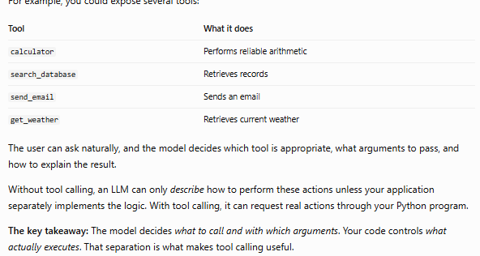
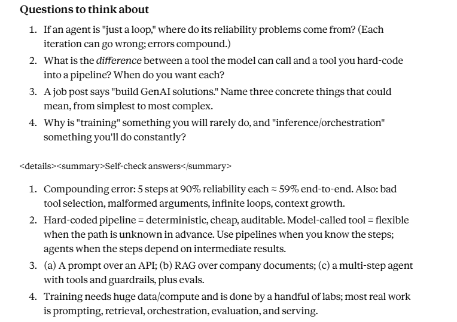

## I learned about sklearn(used for classical ML), TF-IDF(Term Frequescy, Inverse document frequency) which counts words, and gives higher weight to those words which occurrs less across documents. Then used a small training of 8 examples for classification of positive/negative reviews, and ran a test. I used Logistic Regression(for classification) and MLP(multi layer perceptron) classifier(layers, iterations = 2000, has an option to stop early if across 10 consecutive iterations the weight update is not significant, random state =0 - can be reproducible wth same starting weights for same env) and they both produced certain results for new reviews, with words that they haven't even seen before.

## I also called local llm to test for same with the prompt. The observation is the llm is changing it's response when ran with same data multiple times. Need to read on temperatures and what else influence the decision.

## AI(any task that requires intelligence, includes rules engines), ML(labelled data, useds data to learn and then make predicitons, humans give features), DL(subset of ML, uses Neural network, automatically identifies features), Generative AI(generates new text, code, image, video ), LLMs (text input -> text output, generation), Agents (LLMs wrapped with tools, memory and state)

- When would I choose logistic regression in production?
    - Cost: it's very chepa to run
    - Latency - fast predicitons
    - Determinism - Consistnet predicitons for the same input and model
    - Auditability - Easier to inspect feature weights and explain predicitons
    - Scale - Efficient for millions of prediciotns per day liem 10M rows/day

- When the model learns it also has  bias/intercept that it makes use of to give probabilities when from tf-idf it get zero vectors, that is text with no known words, and hten based on thsi bias it gives output

| Question | Local LLM | Open AI | Correct Answer |
|---|---|---|---|
| How many r's are in "strawberry"? | [1,2, 2] | [3, 3] | 3 |
| What is 48213 × 3917? | [188,877,881, 188,919,211, 189,111,281]  | [188,850,321, 188,850,321] | 188,850,321 |


- Why local LLM is producing wrong answers?
    - Models may make arithmetic mistakes because they predict text rather than automatically using a calculator.
    - Models may miscount letters because they process text as tokens, not necessarily individual characters.

## Next I created a simple agent, that uses local model and does a tool call to calculator funciton to calculate result. the code is in m1_agent.py, what i observerd is model is useing the tool call, and is giving correct final resutl, but if it produces and intermediate results those are incorrect and based on models predicition.


role='assistant' content='' thinking=None images=None tool_name=None tool_calls=[ToolCall(function=Function(name='calculator', arguments={'expression': '(48213*3917)/7'}))]
[step 0] model called calculator ({'expression': '(48213*3917)/7'})

role='assistant' content='The result of 48213 multiplied by 3917 is 189,511,841.43. Dividing this result by 7 gives a final answer of 269,786,17.29.' thinking=None images=None tool_name=None tool_calls=None
FINAL:  The result of 48213 multiplied by 3917 is 189,511,841.43. Dividing this result by 7 gives a final answer of 269,786,17.29.

- When calling a model inside a loop which in turn makes a tool call, how does it know when to stop?
    - The model signals whether it wants a tool call in its response. Your code checks that signal. and then loop iteration also provide another safety net.

- When it calls a tool and when it doesn't?
    - You provide the model with both the user's question and the tool description. The model decides whether to request the tool.
    - Tool call: It decides that using the calculator is appropriate.
    - No tool call: It decides to answer directly using its own learned capabilities.
    Providing a tool does not guarantee the model will use it. If you need the calculator to be used every time, you need additional instructions or tool-choice controls supported by your Ollama version.

- Why is this useful if we have to write the tool ourselves?
    - Because I will write the tool once, and it cna be used across many different requests which model will descide.
    
    - How a model decides?
        - Tool-use training: It sees examples where a question calls for a tool, learns the tool-call format, and learns to use tool results in subsequent responses. Some models also improve through reinforcement learning.

```[{'role': 'user', 'content': 'What is 48213*3917 and divide the result by 7'}, Message(role='assistant', content='', thinking=None, images=None, tool_name=None, tool_calls=[ToolCall(function=Function(name='calculator', arguments={'expression': '(48213*3917)/7'}))]), {'role': 'tool', 'name': 'calculator', 'content': '26978617.285714287'}, Message(role='assistant', content='The result of the calculation is 269,786,17.29.', thinking=None, images=None, tool_name=None, tool_calls=None)]```

- If the tool is giving incorrect result it hsould be at the model's discretion to verify the result too right?
    - local llama model was not validating, with chatgpt, even with reasoning_effort='none', it validated and gave correct output

- I have set the iteration to 5, if i remove it what may happen?
    - Normal behavior: The model calls the calculator, receives the result, calls another tool if needed, and eventually produces a final answer.
    - Repeated tool calls: The model keeps requesting tools even when it could answer, so the loop continues making API requests.
    - Repeated identical calls: It may request the same calculation repeatedly, wasting time and money.
    - API error: The loop may stop because of an API error, rate limit, or token limit—but you shouldn't rely on those to control costs.

- How produciotn agents handle this?
    - Step limit: Maximum number of model/tool cycles.
    - Cost or token budget: Stop when the execution budget is exhausted.
    - Timeout: Stop after a maximum duration.
    - Repeated-call detection: Detect when the same tool is called repeatedly with the same arguments.

- A question that required no tool call?
    - Open IA gpt model didn't made any tool calls
    - Local llama made random tool call with random input arguments.
    